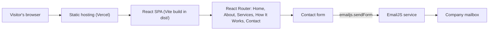

<p align="center"></p>

# STATUTEK

The marketing website for STATUTEK, a startup that offers business compliance and registration services alongside web, SaaS and branding work for early-stage companies.


## Overview

Founders of new Indian businesses often deal with several vendors at once: one for company registration and GST, another for trademarks, and others for the website and brand. STATUTEK positions itself as a single provider for both sides ("Compliance Meets Technology").

This repository is the company's public website. It is a static, client-side React single-page application that presents the services, explains the engagement process and lets visitors send an enquiry through a contact form. There is no backend: the contact form delivers messages through [EmailJS](https://www.emailjs.com/) directly from the browser.

## Key features

- **Five pages** with client-side routing: Home, About, Services, How It Works and Contact ([`src/App.jsx`](src/App.jsx)).
- **Services catalogue** in two groups:
  - Compliance: company registration (Pvt Ltd, LLP, OPC, partnership), GST and tax filing, MSME and Startup India recognition, trademark and IP.
  - Technology and design: web development, SaaS development, logo and branding, digital marketing.
- **How It Works** page describing a four-step process: discovery and consultation, documentation and planning, execution, delivery and support.
- **Contact form** (name, email, phone, service of interest, message) sent with EmailJS, with success and error states, including a specific message for a misconfigured Gmail service ([`src/pages/Contact.jsx`](src/pages/Contact.jsx)).
- **Responsive layout** with a mobile navigation menu, shared footer and scroll-to-top on route change.
- **Animations** with Framer Motion and icons from lucide-react.
- **Navy and gold theme** defined as Tailwind tokens (`primary`, `accent`, `light`) in [`tailwind.config.js`](tailwind.config.js).

## Architecture



| Component | Role |
|---|---|
| [`src/main.jsx`](src/main.jsx), [`src/App.jsx`](src/App.jsx) | Entry point and route table, wrapped in the shared `Layout` and `ScrollToTop`. |
| [`src/components/`](src/components) | `Layout`, `Navbar`, `Footer`, `Section` (page section wrapper) and `ServiceCard`. |
| [`src/pages/`](src/pages) | One component per page; page content is defined inline as arrays of objects. |
| EmailJS | Third-party email delivery for the contact form; configured through `VITE_EMAILJS_*` variables at build time. |
| [`vercel.json`](vercel.json) | Rewrites every path to `index.html` so deep links such as `/about` work on refresh. |

## How it works

1. Vite builds the app into static files in `dist/`, which are served by any static host (the repo is set up for Vercel).
2. React Router renders the requested page inside the common layout; navigation happens in the browser without page reloads.
3. On the Contact page, submitting the form calls `emailjs.sendForm` with the service ID, template ID and public key read from `import.meta.env`.
4. EmailJS fills the template with the form fields and emails it to the configured inbox; the page shows a confirmation or the error returned by EmailJS.

## Tech stack

| Layer | Technologies |
|---|---|
| UI | React 19, React Router 7, Tailwind CSS 3, PostCSS, Autoprefixer |
| Motion and icons | Framer Motion, lucide-react |
| Forms | @emailjs/browser |
| Tooling | Vite 7, ESLint 9 |
| Hosting | Vercel (SPA rewrite config) |

## Project structure

```text
STATUTEK/
├── index.html               # HTML shell
├── src/
│   ├── main.jsx             # React entry point
│   ├── App.jsx              # Routes
│   ├── components/          # Layout, Navbar, Footer, Section, ServiceCard, ScrollToTop
│   ├── pages/               # Home, About, Services, HowItWorks, Contact
│   ├── assets/              # Logo images
│   └── index.css            # Tailwind layers and global styles
├── tailwind.config.js       # Theme colours and font
├── vite.config.js           # Vite + React plugin
├── eslint.config.js
└── vercel.json              # SPA rewrite for Vercel
```

## Getting started

### Prerequisites

- Node.js (a version supported by Vite 7) and npm
- An EmailJS account with an email service and a template, if you want the contact form to send mail

### Install and run

```bash
git clone https://github.com/suriyaprakash-25/STATUTEK.git
cd STATUTEK
npm install
npm run dev        # http://localhost:5173
```

Other scripts:

```bash
npm run build      # production build into dist/
npm run preview    # serve the production build locally
npm run lint       # ESLint
```

### Environment variables

Create a `.env` file in the project root (it is git-ignored) and set the same variables in your hosting provider:

| Variable | Purpose |
|---|---|
| `VITE_EMAILJS_SERVICE_ID` | EmailJS service that sends the mail |
| `VITE_EMAILJS_TEMPLATE_ID` | EmailJS template used for enquiries |
| `VITE_EMAILJS_PUBLIC_KEY` | EmailJS public key for the browser SDK |

These values are embedded in the client bundle at build time, so restrict the allowed origins for your EmailJS account.

### Deploy to Vercel

Import the repository in Vercel; it is detected as a Vite project (build command `npm run build`, output directory `dist`). Add the three environment variables in the project settings before deploying. The included [`vercel.json`](vercel.json) handles client-side routing.

## Limitations

- Content (services, process steps, contact details) is hard-coded in the page components; there is no CMS.
- The contact form depends entirely on EmailJS; there is no server-side validation, spam protection or stored copy of enquiries.
- No automated tests.
- Some images are loaded from Unsplash URLs at runtime.

## Author

Built by [Suriyaprakash](https://github.com/suriyaprakash-25).
